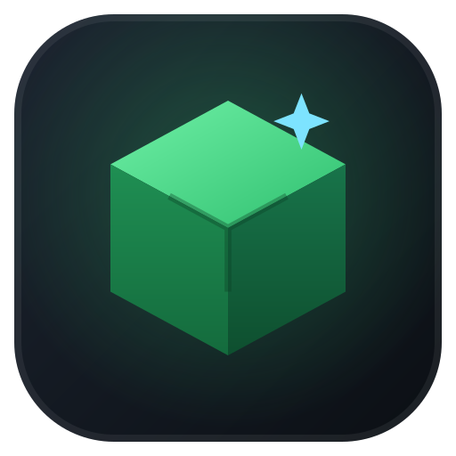
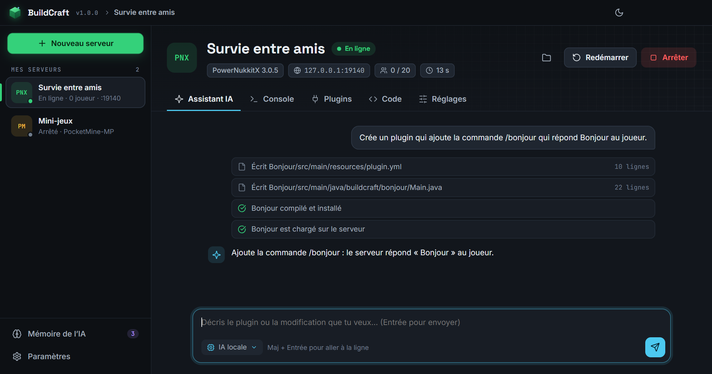
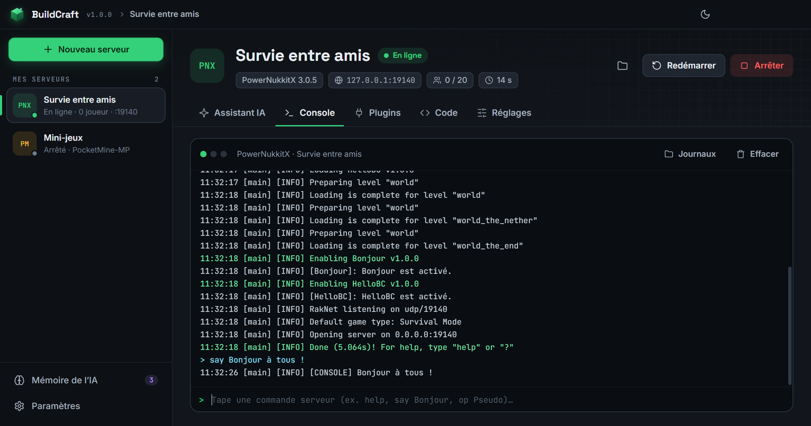
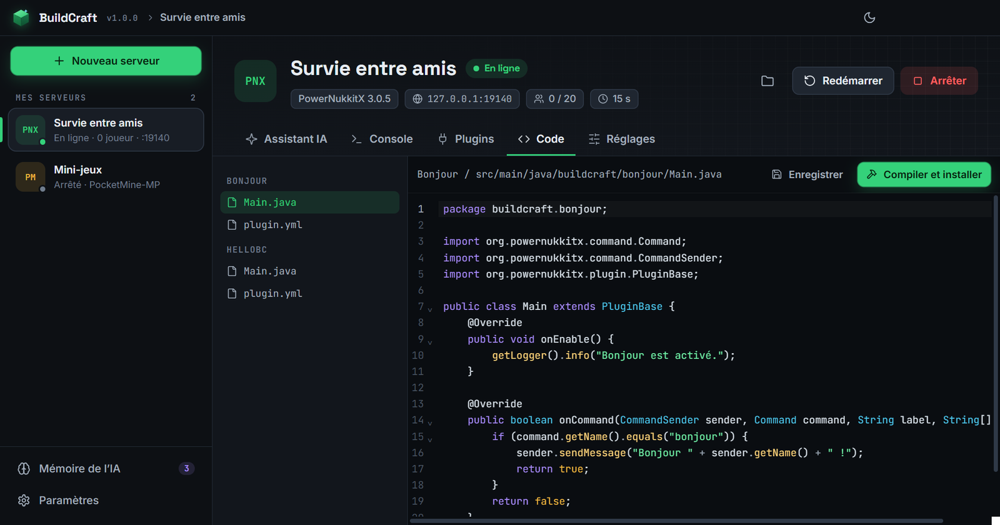
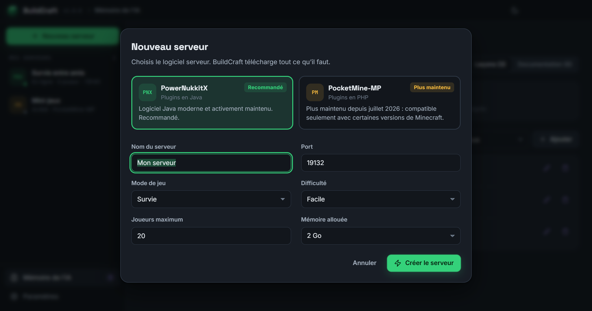
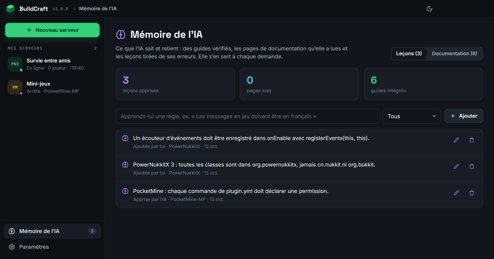
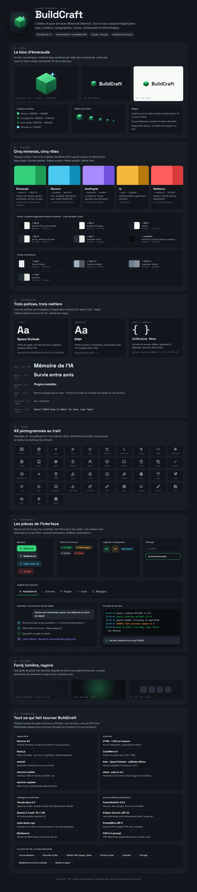

<p align="center">
  
</p>

<h1 align="center">BuildCraft</h1>

<p align="center"><b>L'atelier IA pour serveurs Minecraft Bedrock.</b><br>Crée un vrai serveur en un clic, décris le plugin que tu veux : l'IA lit la documentation, écrit le code, le compile, le teste sur ton serveur et retient ce qu'elle apprend.</p>

<p align="center">
  <a href="https://github.com/Maxence-P-dev/buildcraft/releases/latest/download/BuildCraft-Setup.exe"></a>
  <a href="https://github.com/Maxence-P-dev/buildcraft/releases/latest/download/BuildCraft-Portable.zip"></a>
</p>

<p align="center">
  <a href="https://github.com/Maxence-P-dev/buildcraft/releases/latest"></a>
  
  
  
</p>

<p align="center">
  
</p>

## Comment ça marche

1. **Crée un serveur.** Choisis PowerNukkitX (plugins en Java) ou PocketMine-MP (plugins en PHP). BuildCraft télécharge le logiciel serveur, Java ou PHP, et le configure. Rien à installer à la main.
2. **Décris ton plugin**, en français : « une commande /spawn qui téléporte au point de départ », « un message de bienvenue avec le nombre de joueurs connectés »…
3. **L'IA s'occupe du reste.** Elle cherche dans la documentation, vérifie les vraies classes de l'API du serveur, écrit le code, le compile, corrige ses erreurs, redémarre le serveur et lit la console pour s'assurer que tout marche.
4. **Elle apprend.** Chaque erreur corrigée devient une leçon qu'elle relit la fois suivante. Tu peux voir, modifier ou ajouter ses leçons dans **Mémoire de l'IA**, et lui faire lire n'importe quelle page de documentation.

Ensuite, connecte-toi depuis Minecraft : **Jouer → Serveurs → Ajouter un serveur**, avec l'adresse et le port affichés dans BuildCraft.

## Fonctionnalités

<table>
<tr>
<td width="50%"></td>
<td width="50%"></td>
</tr>
<tr>
<td><b>Console en direct</b> : démarrage, arrêt, redémarrage, commandes serveur, joueurs connectés.</td>
<td><b>Éditeur de code</b> intégré avec coloration Java, PHP et YAML, compilation en un clic.</td>
</tr>
<tr>
<td width="50%"></td>
<td width="50%"></td>
</tr>
<tr>
<td><b>Vrais serveurs</b> PowerNukkitX ou PocketMine-MP, plusieurs en même temps, chacun sur son port.</td>
<td><b>Mémoire de l'IA</b> : guides vérifiés, pages lues sur le web, leçons apprises.</td>
</tr>
</table>

- **Deux moteurs d'IA, au choix**
  - **Claude** (recommandé) : le plus fiable pour coder. Il utilise ta propre clé API ([console.anthropic.com](https://console.anthropic.com)), payée à l'usage : un plugin coûte en général quelques dizaines de centimes. La clé est chiffrée sur ton PC.
  - **IA locale** : gratuite, sans compte et hors ligne. Elle tourne sur ton ordinateur (Qwen2.5-Coder, 1 à 5 Go à télécharger une fois). Plus lente et plus limitée, idéale pour des petits plugins.
- **L'IA travaille vraiment sur ton serveur** : elle crée les fichiers, compile (`javac` ou `php`), installe le plugin, redémarre, lit les journaux et peut envoyer des commandes de test.
- **Elle vérifie l'API au lieu de l'inventer** : elle inspecte directement le `.jar` de PowerNukkitX ou le `.phar` de PocketMine installé.
- **Réglages du serveur** sans toucher aux fichiers : nom, MOTD, port, mode de jeu, difficulté, joueurs max, liste blanche, mémoire.
- **Thème sombre ou clair**, interface entièrement en français.
- **Mises à jour automatiques** : BuildCraft te prévient quand une nouvelle version sort et l'installe en un clic.

> [!IMPORTANT]
> **PocketMine-MP n'est plus maintenu depuis juillet 2026.** Il reste disponible pour les plugins existants, mais les joueurs sur la dernière version de Minecraft risquent de ne plus pouvoir s'y connecter. Pour un serveur durable, choisis **PowerNukkitX**.

## Installation

1. Clique sur **[Télécharger l'installeur](https://github.com/Maxence-P-dev/buildcraft/releases/latest/download/BuildCraft-Setup.exe)**.
2. Ouvre `BuildCraft-Setup.exe` et clique sur **Suivant** jusqu'à la fin.
3. Dans BuildCraft, clique sur **Nouveau serveur**.

**Sans installation ?** Prends la [version portable](https://github.com/Maxence-P-dev/buildcraft/releases/latest/download/BuildCraft-Portable.zip), décompresse-la et lance `BuildCraft.exe`.

Les serveurs sont créés dans `Documents\BuildCraft\serveurs` (modifiable dans les Paramètres). Chaque serveur est un dossier normal : tu peux le sauvegarder, le copier ou l'ouvrir avec tes propres outils.

> [!NOTE]
> L'application n'est pas signée numériquement. Si Windows affiche « Windows a protégé votre ordinateur », clique sur **Informations complémentaires**, puis sur **Exécuter quand même**. Au premier démarrage d'un serveur, autorise BuildCraft dans le pare-feu Windows pour que tes amis puissent se connecter sur le réseau local.

## Charte graphique

<p align="center">
  
</p>

## Développement

Il faut [Node.js](https://nodejs.org) 22 ou plus récent.

```bash
npm install
npm start        # lance l'application
npm run dist     # crée l'installeur et le zip dans release/
```

Le code est organisé ainsi :

- `app/main.js` : fenêtre, réglages, clé API, pont IPC
- `app/core/servers.js` : création, démarrage, console et réglages des serveurs
- `app/core/software.js` et `runtimes.js` : téléchargement de PowerNukkitX, PocketMine-MP, Java 25 et PHP 8.4
- `app/core/builder.js` : projets de plugins, compilation `javac` / `.phar`
- `app/core/agent.js` : l'agent Claude et ses outils (fichiers, compilation, console, documentation)
- `app/core/local-ai.js` : l'IA locale (génération JSON contrainte, compilation, corrections)
- `app/core/knowledge.js` : la mémoire (guides, pages web, leçons, recherche BM25, lecture de l'API)
- `src/renderer/` : interface (serveurs, assistant, console, éditeur, mémoire, paramètres)

## Licence

MIT pour le code de BuildCraft. BuildCraft n'est pas affilié à Mojang, Microsoft, PowerNukkitX ni PocketMine-MP.

- Serveurs téléchargés depuis leurs sources officielles : [PowerNukkitX](https://github.com/PowerNukkitX/PowerNukkitX) (LGPL-3.0), [PocketMine-MP](https://github.com/pmmp/PocketMine-MP) (LGPL-3.0), Java [Eclipse Temurin](https://adoptium.net), [PHP](https://github.com/pmmp/PHP-Binaries).
- IA locale : [Qwen2.5-Coder](https://huggingface.co/Qwen/Qwen2.5-Coder-7B-Instruct) (Apache 2.0), exécutée avec [node-llama-cpp](https://github.com/withcatai/node-llama-cpp).
- Polices : Inter, Space Grotesk et JetBrains Mono (SIL Open Font License).
